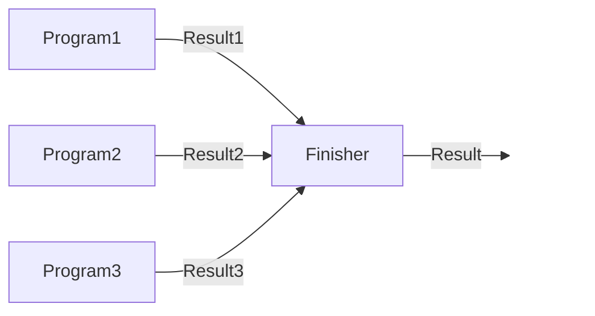

# Diesel

[](https://maven-badges.sml.io/sonatype-central/com.github.tonivade/diesel/)
[](LICENSE)

**Diesel** is a Java library for describing effectful programs, composing them sequentially or concurrently, and generating type-safe domain-specific language (DSL) APIs with an annotation processor.

A `Program<S, E, T>` describes a computation that uses a context of type `S`, can fail with an error of type `E`, and produces a value of type `T`. Programs are declarative: building a program does not run its effects. Evaluation starts only when you call `eval(...)` or another evaluation method.

> Diesel is under active development. APIs and behavior may change between releases.

## Contents

- [Requirements](#requirements)
- [Installation](#installation)
- [Quick start: generate a DSL](#quick-start-generate-a-dsl)
- [The Program model](#the-program-model)
- [Composing programs](#composing-programs)
- [Errors and recovery](#errors-and-recovery)
- [Validation](#validation)
- [Concurrency](#concurrency)
- [Shared state and synchronization](#shared-state-and-synchronization)
- [Asynchronous operations](#asynchronous-operations)
- [Cancellation and resource safety](#cancellation-and-resource-safety)
- [Retries, repetition and timing](#retries-repetition-and-timing)
- [Evaluation](#evaluation)
- [Source](#source)
- [License](#license)

## Requirements

- **Java 25**.
- Gradle or Maven, depending on your project.

Diesel uses modern Java APIs and language features. Make sure both the JDK used to compile your project and the compiler configuration target a compatible Java version.

## Installation

The library and its annotation processor are published under `com.github.tonivade:diesel`.

### Gradle (Kotlin DSL)

Add Diesel to both the compile classpath and the annotation processor path:

```kotlin
dependencies {
    implementation("com.github.tonivade:diesel:0.13")
    annotationProcessor("com.github.tonivade:diesel:0.13")
}
```

For snapshot builds, add the Sonatype snapshots repository to your repositories configuration:

```kotlin
maven {
    url = uri("https://central.sonatype.com/repository/maven-snapshots/")
}
```

### Maven

Add the library as a dependency:

```xml
<dependency>
    <groupId>com.github.tonivade</groupId>
    <artifactId>diesel</artifactId>
    <version>0.13</version>
</dependency>
```

Configure the annotation processor in the Maven Compiler Plugin as well:

```xml
<plugin>
  <groupId>org.apache.maven.plugins</groupId>
  <artifactId>maven-compiler-plugin</artifactId>
  <version><!-- use your project's compatible version --></version>
  <configuration>
    <annotationProcessorPaths>
      <path>
        <groupId>com.github.tonivade</groupId>
        <artifactId>diesel</artifactId>
        <version>0.13</version>
      </path>
    </annotationProcessorPaths>
  </configuration>
</plugin>
```

## Quick start: generate a DSL

Annotate an interface that describes the capabilities your program needs. Diesel's annotation processor generates a companion DSL interface with static methods that return `Program` values.

```java
import com.github.tonivade.diesel.Diesel;

@Diesel
public interface Console {
    String readLine();
    void writeLine(String line);
}
```

By default, the generated interface is named `ConsoleDsl`. Its methods represent the original operations as programs, conceptually like this:

```java
public interface ConsoleDsl {
    static <S extends Console, E> Program<S, E, String> readLine() {
        return Program.access(Console::readLine);
    }

    static <S extends Console, E> Program<S, E, Unit> writeLine(String line) {
        return Program.inspect(console -> console.writeLine(line));
    }
}
```

Void-returning service methods use `Unit` as the program result, so they compose like any other successful operation without introducing a nullable `Void` value.

Compose the generated operations, then supply a concrete implementation of the context when evaluating:

```java
import static com.example.ConsoleDsl.*;
import static com.github.tonivade.diesel.Combine.pipe;

public class Main {
    public static void main(String... args) {
        var program = pipe(
            writeLine("What's your name?"),
            ignored -> readLine(),
            name -> writeLine("Hello " + name + "!")
        );

        Console console = new Console() {
            @Override
            public String readLine() {
                return IO.readln();
            }

            @Override
            public void writeLine(String line) {
                IO.println(line);
            }
        };

        program.eval(console);
    }
}
```

The example assumes the interface and generated DSL are in the indicated package; replace `com.example` with your package.

### Annotation options and supported return types

- `@Diesel` generates a DSL named after the annotated type with the `Dsl` suffix.
- `@Diesel("CustomName")` lets you choose the generated type name.
- `@Diesel(errorType = MyError.class)` sets the default error type used by generated programs. The default is `Void.class`, meaning no specific typed error is declared.
- Generic service methods are supported. Their type variables are carried into the generated methods; avoid naming service type variables `S` or `E`, which Diesel reserves for program context and error types.
- Methods returning ordinary values, `void`, `Result` values, or `CompletableFuture` values can be represented in the generated DSL. Subtypes of `Result` and `CompletableFuture` are supported, as are bounded wildcard return types when their bounds provide a usable value type. A method returning `void` is represented as `Program<S, E, Unit>`; `Void` is not a valid result type inside `Result` or `CompletableFuture`—use `Unit` instead. The processor also checks that the error type of a returned `Result` is compatible with the `errorType` declared by `@Diesel`.

For asynchronous DSL operations, Diesel bridges the future into program evaluation. Cancellation of a generated future-backed operation cancels the returned future; if the future is shared or cached, return a copy when cancellation must not affect other consumers.

## The Program model

The central type is:

```java
Program<S, E, T>
```

- `S` — the environment/context required to run an operation.
- `E` — the typed error returned by a failed program.
- `T` — the successful result.

Useful constructors include:

```java
Program.<MyContext, MyError, String>success("hello");
Program.<MyContext, MyError, String>failure(error);
Program.<MyContext, MyError, String>suspend(() -> buildNextProgram());
Program.<MyContext, MyError, Integer>attempt(() -> parseInput());
Program.<MyContext, MyError>task(() -> performSideEffect());
```

`success` and `failure` create completed program descriptions. `suspend` delays construction of the next program until evaluation, which is useful for recursive programs because recursion is handled by Diesel's interpreter rather than by recursively evaluating on the Java call stack. `attempt` captures thrown exceptions as failures; an overload lets you map exceptions to your own error type.

The interpreter uses an explicit continuation stack to process program composition. This makes deeply composed and suspended programs stack-safe without requiring a chain of nested Java calls. `Unit` is Diesel's single-value type for computations whose meaningful outcome is completion rather than a data value; `Program.task(...)`, `Program.sleep(...)`, and generated DSL methods returning `void` use it.

## Composing programs

Import the combinators you use, or call them through `Combine`.

### Sequential composition: `pipe`, `flatMap`, and `map`

Use `pipe` to pass the successful result of one program to the next program. A failure short-circuits the pipeline.

```java
var greeting = pipe(
    readLine(),
    name -> writeLine("Hello " + name + "!"),
    _ -> writeLine("Welcome.")
);
```

Maybe is clearer in a diagram how `pipe` works:


For two-step composition, `flatMap` is the core operation. Use `map` when the next step is a plain value-producing function, and `andThen` when the next program does not need the previous result.

`Combine` also provides `chain` for applying a sequence of value transformations and `traverse` for working with collections of programs.

### Combining independent results: `zip`

Use `zip` when several programs can be evaluated in sequence and their results should be combined by a finisher:

```java
var combined = Combine.zip(
    loadUser(),
    loadPreferences(),
    (user, preferences) -> new UserView(user, preferences)
);
```

Maybe is clearer in a diagram how `zip` works:



`zip` propagates a failure and calls the finisher only when all inputs succeed. Generated overloads support combining multiple programs.

For parallel combination, use `Concurrent.parZip` (see [Concurrency](#concurrency)).

## Errors and recovery

A program can represent a typed failure (`E`) or throw an exception while it runs. These are distinct mechanisms:

- `flatMapError` and `mapError` transform typed failures.
- `catchAll` catches thrown exceptions and lets you recover with another program.
- `foldMap` handles both typed failure and success by returning a program from either branch.
- `fold` handles both branches and maps them to a value.
- `peek` and `peekError` allow observation of a successful value or typed error without changing it.

Example of recovering from an exception:

```java
var safe = riskyOperation()
    .catchAll(error -> fallbackOperation());
```

Example of mapping a typed error:

```java
var userFacing = loadUser()
    .mapError(error -> new PublicError(error.message()));
```

## Validation

Diesel includes `Validation` and `Validator` for validating values and accumulating validation errors.

A validator selects a property, checks it with a predicate, and provides an error when the check fails:

```java
record User(Integer id, String name) {}

var validation = validate(
    user,
    Validator.of(User::id, id -> id != null, "Id must not be null"),
    Validator.of(User::name,
        name -> name != null && !name.isBlank(),
        "Name must not be blank")
);
```

When all validators pass, validation succeeds with the original value. When checks fail, their errors are accumulated in the invalid validation result instead of stopping at the first invalid field. You can then convert or compose that result as a `Program`.

## Concurrency

The `Concurrent` class provides combinators for running programs concurrently. Overloads without an explicit executor use a shared default executor backed by **virtual threads**. Overloads accepting an `Executor` let you control scheduling.

```java
import static com.github.tonivade.diesel.Concurrent.*;

var userAndOrders = parZip(
    loadUser(),
    loadOrders(),
    (user, orders) -> new UserAndOrders(user, orders)
);

var allChecks = parAll(checkPermissions(), checkAccount(), checkLimits());
```

Available combinators include:

- **`parZip`** — run programs in parallel and combine their successful results.
- **`parAll`** — run all programs in parallel and ignore their values.
- **`parSequence`** — run a collection of programs in parallel and collect their successful values.
- **`parAny`** — return the first successful result among multiple programs.
- **`either`** — race two programs and return the first one to finish without an error/exception.
- **`race`** — race two programs and return the first one to finish, including a failure.

The `either` and `race` results are represented by `Either`, distinguishing which branch won. The difference is important: `either` waits for the first branch that completes successfully, while `race` is won by the first branch to finish.

The parallel collection combinators are fail-fast: when one child fails, the others are cancelled. Diesel waits for cancelled children to stop and run their finalizers before the combined program completes. Cancellation is cooperative: arbitrary code already running inside ordinary `task` or `supply` does not automatically stop in the middle of a blocking call.

To choose a custom executor:

```java
Executor executor = Executors.newFixedThreadPool(8);

var result = parZip(
    firstOperation(),
    secondOperation(),
    (first, second) -> combine(first, second),
    executor
);
```

Choose an executor appropriate to the work. Virtual threads are a good default for blocking I/O; a bounded platform-thread pool may be more appropriate for CPU-bound work or when you need an explicit concurrency limit.

## Shared state and synchronization

Diesel provides two small primitives for coordinating programs that share state.

### Atomic references: `Ref`

`Ref<A>` is a mutable, thread-safe reference intended for storing immutable values. Its operations are programs, so reads and updates participate in normal composition, cancellation, and evaluation.

Create a reference inside a program with `Ref.make(initialValue)` when each evaluation must get independent state, or use `Ref.of(initialValue)` to create one immediately:

```java
Program<Void, Void, Integer> counter = Ref.<Void, Void, Integer>make(0)
    .flatMap(ref -> Program.task(() -> ref.update(n -> n + 1))
        .andThen(ref.get()));

counter.evalOrElseThrow(); // 1
```

Available operations include:

- `get()` — read the current value.
- `set(value)` — replace it.
- `getAndSet(value)` — replace it and return the previous value.
- `update(function)` — atomically update it.
- `updateAndGet(function)` — update it and return the new value.
- `getAndUpdate(function)` — update it and return the previous value.
- `modify(function)` — atomically compute a result and a replacement value, returning the result.

Updates are atomic. Functions passed to `update`, `updateAndGet`, `getAndUpdate`, and `modify` may be invoked more than once under contention, so keep them free of side effects.

### One-shot synchronization: `Deferred`

`Deferred<A>` starts empty and can be completed once. Programs calling `get()` wait for the value; completing it wakes all current waiters. A later completion returns `false` and leaves the original value unchanged.

```java
Program<Void, Void, String> exchange = Deferred.<String>make()
    .flatMap(deferred ->
        deferred.get().fork()
            .flatMap(waiter ->
                deferred.complete("ready")
                    .andThen(Program.join(waiter))));
```

The main operations are:

- `get()` — wait for the value; returns immediately if it is already available.
- `complete(value)` — set the value once and wake waiting programs; returns whether this call completed it.
- `tryGet()` — inspect the value without waiting, as an `Optional<A>`.
- `Deferred.make()` — create a fresh deferred when the returned program is evaluated.
- `Deferred.create()` — create an empty deferred immediately.

A program waiting in `get()` can be cancelled without cancelling other waiters or changing the deferred value. The value cannot be `null`. Waiting holds a thread, which is inexpensive with virtual threads; avoid waiting forever inside an uncancelable region.

## Asynchronous operations

Diesel can wait for external asynchronous work and integrate it into a program.

### Wait for a future

`Program.join(future)` waits for a `CompletableFuture<Result<E, T>>`. Cancelling the waiting program does **not** cancel the original future. Generated DSL methods can also return `CompletableFuture<Result<E, T>>` directly; Diesel unwraps the `Result` into the program's typed success or failure. This works with subclasses of `CompletableFuture` and `Result` as well.

### Register a cancelable asynchronous operation

Use `Program.asyncCancelable` when you can provide a cancellation action for the underlying operation:

```java
Program.<MyContext, MyError, String>asyncCancelable((context, callback) -> {
    var request = startRequest(context, callback);
    return Program.task(() -> request.cancel());
});
```

The registration function starts the operation, completes the supplied callback future when the result is ready, and returns a program that cancels the operation. If the Diesel program is cancelled while waiting, that canceler runs before cancellation continues. It is not run after normal completion. The registration function must return a non-null canceler; if it throws after starting external work, it is responsible for cleaning that work up.

Use `Program.async` when cancellation should stop waiting but the external operation should continue.

### Fork a program

`fork()` runs a program asynchronously and returns a future for its result. The no-argument `fork()` uses Diesel's default executor; an overload accepts an `Executor`. The returned future is cancelable and tied to the fork's cancellation token.

### Timeout and sleep

`timeout(Duration)` runs a program with a time limit and uses the default executor; an overload lets you supply an executor. `sleep(Duration)` represents a delay as a program, so the delay composes with the same cancellation and error-handling behavior as other operations.

## Cancellation and resource safety

Cancellation is cooperative and integrated with the interpreter. A cancelled program stops at its next cancellation point, unwinds its continuation stack, and runs registered finalizers. A running arbitrary Java function is not forcibly stopped unless the operation itself supports interruption or cancellation. Fatal JVM errors such as `VirtualMachineError` (including `OutOfMemoryError` and `StackOverflowError`) are rethrown rather than converted into ordinary program failures; `catchAll` does not recover from them and finalizers are not run after such a fatal error.

### Finalizers: `ensuring` and `onCancel`

- `ensuring(finalizer)` runs the finalizer after success, typed failure, an exception, or cancellation.
- `onCancel(finalizer)` runs the finalizer only when the program is cancelled.
- Finalizers themselves are uncancelable, so cleanup is allowed to finish.

### Bracketed resources

Use `bracket` when a resource must be acquired and reliably released:

```java
var program = Program.bracket(
    acquireConnection(),
    connection -> useConnection(connection),
    connection -> releaseConnection(connection)
);
```

The release action is protected against cancellation and runs after the use program finishes, fails, throws, or is cancelled. This is the preferred shape for resource lifecycles that must not leak.

### Uncancelable regions

An uncancelable region defers cancellation until the protected computation completes. Use it sparingly, especially around potentially blocking operations, because cancellation must wait for that region to finish.

### Interruptible tasks

`Program.interruptibleTask(action)` runs an interruptible action on the common fork-join pool. Its executor overload allows you to choose a different executor, including one backed by virtual threads. When cancellation occurs, the running thread is interrupted and Diesel waits for the action to return before running finalizers. If the action ignores interruption, cancellation waits for it to finish.

Use this for blocking actions that respond correctly to thread interruption. For ordinary tasks, cancellation does not automatically interrupt arbitrary Java code.

## Retries, repetition and timing

Programs can express common control-flow policies without executing them during construction.

```java
var retried = callRemoteService()
    .retry(3, Duration.ofSeconds(1));

var repeated = refreshCache()
    .repeat(5, Duration.ofSeconds(10));

var measured = computeReport().timed();
```

- **`retry(n)`** retries after typed failure up to the configured number of retries. The original attempt is not counted as a retry.
- **`retry(n, delay)`** waits for the given `Duration` between retries; you can also supply a delay program.
- **`repeat(n)`** repeats after successful completion the configured number of additional times. A duration or program can be used as the delay between repetitions.
- **`timed()`** returns the program's result together with elapsed-time information.
- **`memoize()`** creates a program that caches its first evaluated success or typed failure for subsequent evaluations.

Retries and repetition re-evaluate the underlying program, so effects in that program can happen more than once.

## Evaluation

Creating and composing a program is lazy; effects run when you evaluate it.

```java
Result<MyError, String> result = program.eval(context);
```

- `eval()` evaluates without a context (equivalent to a null state).
- `eval(context)` evaluates using the supplied context and returns `Result<E, T>`.
- `evalOrElseThrow()` returns the success value or throws on failure.
- `evalOrElseThrow(mapper)` maps a typed error to the exception to throw.

Prefer inspecting the `Result` when the error is part of normal application control flow. Use `evalOrElseThrow` at boundaries where exception-based handling is appropriate.

## Source

`Source<S, E, T>` is a lazy sequence of `Program`s, similar to a stream in fs2 or ZIO Streams.
Each element is a `Program<S, E, T>` that is evaluated one at a time, only when the source is
traversed, so a `Source` can be infinite and its elements can have effects and fail.

A `Source` is **cold**: nothing is memoized between traversals, so each traversal (`foldLeft`,
`toList`, ...) evaluates the programs again, including their effects. Elements can't be `null`.

```java
var program = Source.<Void, Void, Integer>iterate(1, x -> x + 1)
    .filter(x -> x % 2 == 0)
    .map(x -> x * x)
    .take(5)
    .toList();

program.evalOrElseThrow(); // [4, 16, 36, 64, 100]
```

### Creating a source

| Method | Description |
|---|---|
| `Source.empty()` | A source with no elements |
| `Source.of(value)` / `Source.of(values...)` | A source with the given values |
| `Source.eval(program)` | A source with one program |
| `Source.nonEmpty(head, tail)` | A source with a head program and a tail source |
| `Source.supply(supplier)` | Obtains the program lazily, when traversed |
| `Source.suspend(supplier)` | Obtains the source lazily, when traversed |
| `Source.iterate(seed, f)` | Infinite source: `seed`, `f(seed)`, `f(f(seed))`, ... |
| `Source.iterate(supplier)` | Infinite source calling the supplier for each element |
| `Source.from(iterable)` | From an `Iterable`, calling `iterator()` on each traversal |
| `Source.fromIterator(supplier)` | From an iterator obtained on each traversal |
| `Source.fromStream(supplier)` | From a `Stream` obtained on each traversal |

`from`, `fromIterator` and `fromStream` obtain the iterator inside the evaluation, not when the
source is built, so the source can be traversed more than once if the supplier creates a new one.
Inside a traversal the elements are memoized, so a tail obtained with `split()` can be traversed
several times without advancing the iterator again.

### Transforming a source

```java
Source<Void, String, Integer> source = Source.of(1, 2, 3, 4);

source.map(x -> x * 2);                          // 2, 4, 6, 8
source.mapEval(x -> Program.success(x + 1));     // effectful map: 2, 3, 4, 5
source.flatMap(x -> Source.of(x, x * 10));       // 1, 10, 2, 20, ...
source.filter(x -> x % 2 == 0);                  // 2, 4
source.filterNot(x -> x % 2 == 0);               // 1, 3
source.collect(x -> x % 2 == 0, x -> x * 10);    // filter + map: 20, 40
source.take(2);                                  // 1, 2
source.drop(2);                                  // 3, 4
source.takeWhile(x -> x < 3);                    // 1, 2
source.dropWhile(x -> x < 3);                    // 3, 4
```

### Combining sources

```java
Source.zip(Source.of("a", "b"), Source.of(1, 2, 3)); // (a, 1), (b, 2)
Source.zipWithIndex(Source.of("a", "b", "c"));       // (a, 0), (b, 1), (c, 2)
Source.interleave(Source.of(1, 2, 3), Source.of(4, 5, 6)); // 1, 4, 2, 5, 3, 6

Source.of(1, 2).concat(Source.of(3));  // 1, 2, 3
Source.of(2, 3).prepend(Program.success(1)); // 1, 2, 3
Source.of(1, 2).append(Program.success(3));  // 1, 2, 3
```

`concat` and `append` can be used in a loop: the concatenations are reassociated, so traversing
a source built with 100,000 of them is linear.

### Consuming a source

A source does nothing until you build a `Program` that traverses it and evaluate it:

```java
Source<Void, Void, Integer> source = Source.of(1, 2, 3);

source.toList();                      // Program<Void, Void, List<Integer>>
source.foldLeft(0, Integer::sum);     // Program<Void, Void, Integer>
source.headOption();                  // Program<Void, Void, Optional<Integer>>
source.split();                       // head program and tail source, without evaluating the head
```

`foldRight` receives the folded remainder as a `Program`, so it is stack safe and can stop early,
even on an infinite source:

```java
var exists = Source.<Void, Void, Integer>iterate(0, x -> x + 1)
    .foldRight(
        Program.<Void, Void, Boolean>success(false),
        (x, rest) -> x > 3 ? Program.success(true) : rest);

exists.evalOrElseThrow(); // true, only 5 elements are evaluated
```

### Things to keep in mind

- **`tail()` and `drop(n)` evaluate the discarded elements**, so their effects happen and their
  failures are propagated. Use `split()` to get the remaining source without evaluating the head.
- **`take(n)` doesn't evaluate the element after the last one taken**, so it stops filters and
  infinite sources safely.
- **`head()` of an empty source raises a `NoSuchElementException`** (it is thrown, not a failure of
  type `E`). Use `headOption()` or `split()` to handle it without an exception.
- **The `begin` of `foldLeft` is shared by every evaluation**, so it must be immutable. For a
  mutable accumulator create it inside the evaluation, like `toList()` does:
  `Program.suspend(() -> source.foldLeft(new ArrayList<>(), ...))`.
- **`fromStream` never closes the stream.** If it holds a resource, acquire it with
  `Program.bracket`:

```java
Program<Void, String, String> readFile(String file) {
  return Program.bracket(
      Program.supply(() -> newBufferedReader(file)),
      reader -> Source.<Void, String, String>fromStream(reader::lines)
          .foldLeft("", (a, b) -> a + '\n' + b));
}
```

- Traversals are programs, so everything else works with them: `timeout`, `retry`, `catchAll`,
  cancellation, `parZip`, etc. For example, `source.foldLeft(...).timeout(Duration.ofMillis(100))`
  stops the traversal of an infinite source.
- The same tail must not be traversed concurrently (from two forks): the iterator behind
  `from*` isn't thread-safe.

## License

Diesel is distributed under the [MIT License](LICENSE).
